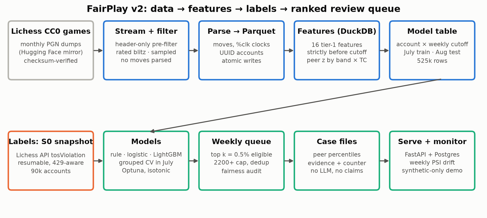
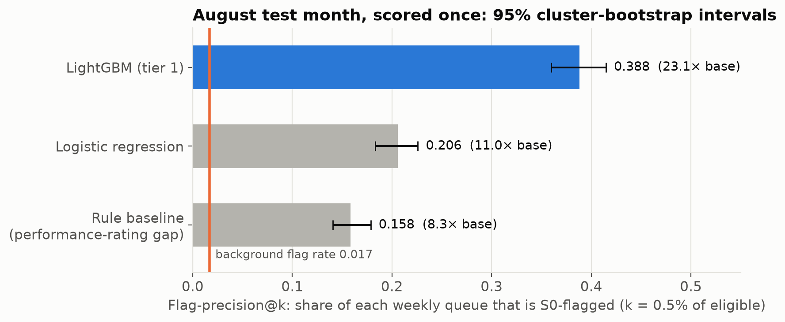
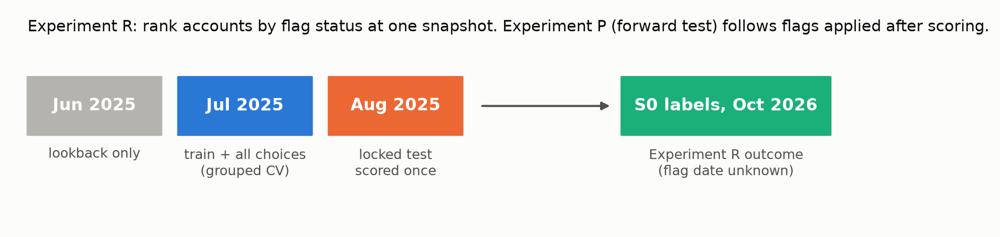
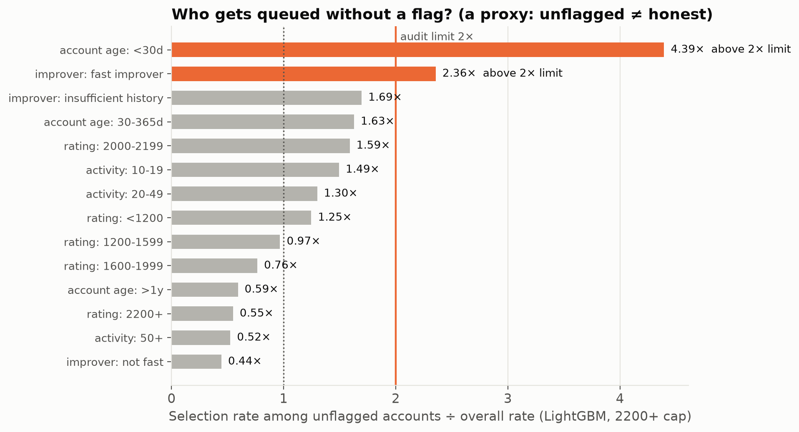
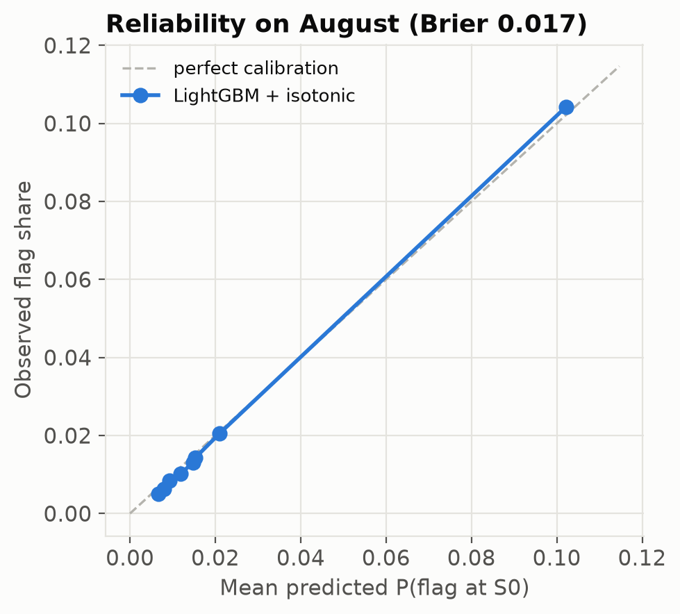
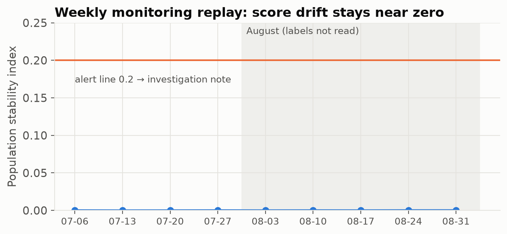
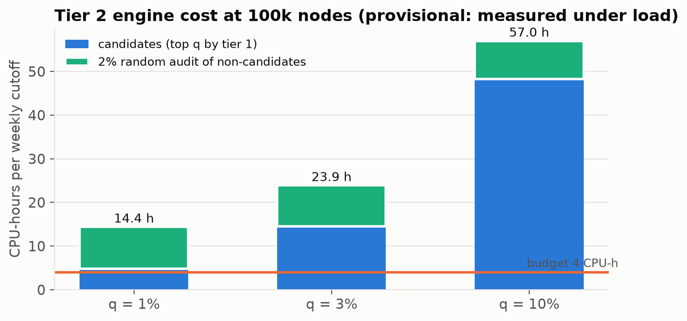

# FairPlay — anti-cheat account prioritisation

A moderation team can only review so many accounts a week. FairPlay ranks player accounts by
how likely they are to carry a moderator flag, using only their behaviour before a cutoff, so
the team sees the most likely cases first. It is built on public Lichess blitz games and
moderation labels.

FairPlay does not decide anything about an account. It produces a ranked weekly queue with a
case file for each account, and a human clears, watches or escalates. A score is a
prioritisation signal, not evidence of wrongdoing.



## Headline result

At a review capacity of 0.5% of active accounts per week, the LightGBM queue on a locked test
month (August 2025, scored once) was:

| Model | Flag-precision@k | 95% CI | Lift over base rate |
|---|---|---|---|
| Rule baseline (performance-rating gap) | 0.158 | 0.141–0.179 | 8.3× |
| Logistic regression | 0.206 | 0.183–0.226 | 11.0× |
| **LightGBM** | **0.388** | **0.360–0.415** | **23.1×** |

Both pre-registered comparisons hold: LightGBM is +23.0 points over the rule and +18.2 points
over logistic regression. Both paired bootstrap intervals are well above zero.



**What this means and what it doesn't.** The label is Lichess's terms-of-service flag at one
snapshot, and the API can't say when a flag was applied. So the result shows how well behaviour
ranks accounts by flag status. It is not a cheating-detection rate and not a forward
prediction. A prospective follow-up scores accounts first, freezes and hashes the scores, and
checks for flags applied afterwards.

## How it works

1. **Ingest.**
   - Monthly game dumps are streamed and pre-filtered on headers only (rated blitz, sampled
     accounts), so moves are parsed only for kept games.
   - Kept games are written to Parquet with atomic writes; every step can resume after a
     crash.
2. **Features.** Sixteen behavioural features are computed in DuckDB SQL, strictly from games
   before each weekly cutoff:
   - timing: think-time variation, even timing, instant moves;
   - clock use;
   - results against expectation;
   - rating trajectory.

   Tier 1 uses no chess engine.
3. **Labels.** A single-threaded, cached and resumable fetcher reads flag status from the
   Lichess API, respecting its rate limits. It labelled 90,000 accounts.
4. **Splits.**
   - June 2025 is lookback only. July is training, and every model choice there is made by
     5-fold cross-validation grouped by account. August is scored once.
   - A game counts for a cutoff only if it started at least 30 minutes before it.



5. **Models.** A rule baseline, logistic regression, and LightGBM (Optuna tuning, isotonic
   calibration).
6. **Weekly queue.** Each week takes the top 0.5% of eligible accounts and limits 2200+ rated
   players to their fair share.
7. **Evaluation.** Flag-precision per weekly queue is averaged over the month. Intervals come
   from a cluster bootstrap over accounts (1,000 resamples), paired for model comparisons. A
   model only "beats" another if the interval is above zero *and* the gain is at least 2
   points.
8. **Case files.** Each queued account gets a deterministic file with the evidence (peer
   percentiles within its rating band), the counter-evidence, and its most extreme games.
9. **Serving and monitoring.**
   - A FastAPI + Postgres service ingests finished games idempotently and recomputes features
     with the same SQL as training.
   - A weekly job builds the queue, and PSI tracks drift.

## Fairness audit

Each group's selection rate among unflagged accounts is compared with the overall rate. Two
groups were above the 2× limit: accounts under 30 days old and fast improvers.

The pre-registered fix order was followed:
1. Find the feature driving the gap.
2. Remove it if it has no behavioural meaning. Account age went, at no measurable precision
   cost.
3. Leave group-specific thresholds as a policy decision. They were not applied.

The remaining gaps come from rating-gain behaviour, which is the signal itself, and are
reported as a limitation. Unflagged doesn't mean honest, so this audit is a proxy.



## Calibration and drift

Calibrated probabilities sit close to the diagonal (Brier 0.017). Replaying the frozen model
week by week shows almost no score drift (PSI ≤ 0.0003; the alert line is 0.2).

<p>
  
  
</p>

## Engine cost: measure before building

A second stage would rerank top candidates with Stockfish features. The cost was measured
first:
- 237 positions per account at 0.125 s each;
- the cheapest setting needs 14.4 CPU-hours per week, against a 4-hour budget.

The stage was dropped and the queue stays on tier 1. The timing was taken on a busy machine and
will be re-measured idle.



## In progress

- **Synthetic benchmark.**
  - Players are simulated with Maia, a neural model that plays like humans at a given rating.
  - Engine-assisted accounts replace some of their moves with Stockfish moves.
  - There are three strategies, one held out, and results are always compared against
    synthetic honest controls.
- **Blind hand review** of 120 accounts by two reviewers, with Cohen's kappa.
- **Prospective test.** Scores were frozen before the outcome snapshot was fetched.

## All reported numbers

This table is generated from logged runs (`python -m fairplay.report build`), and CI fails if
the README block differs from it.

<!-- results:start -->
| Experiment | Split | Claim | Value | 95% CI | Run |
|---|---|---|---|---|---|
| R | test (Aug) | flag-precision@k (c = 0.5%), LightGBM | 0.388 | 0.360 – 0.415 | `20261030T073356Z_final` |
| R | test (Aug) | flag-precision@k (c = 0.5%), logistic regression | 0.206 | 0.183 – 0.226 | `20261030T073356Z_final` |
| R | test (Aug) | flag-precision@k (c = 0.5%), rule baseline | 0.158 | 0.141 – 0.179 | `20261030T073356Z_final` |
| R | test (Aug) | lift@k, LightGBM (× background rate) | 23.115 | 21.327 – 24.916 | `20261030T073356Z_final` |
| R | test (Aug) | flag-recall@k, LightGBM | 0.339 | 0.319 – 0.360 | `20261030T073356Z_final` |
| R | test (Aug) | flag-PR-AUC, LightGBM | 0.379 | 0.355 – 0.402 | `20261030T073356Z_final` |
| R | test (Aug) | LightGBM − rule, flag-precision (pre-registered) | 0.230 | 0.204 – 0.252 | `20261030T073356Z_final` |
| R | test (Aug) | LightGBM − logistic regression, flag-precision (pre-registered) | 0.182 | 0.159 – 0.207 | `20261030T073356Z_final` |
| R | test, unseen | flag-precision@k, LightGBM, unseen accounts | 0.769 | 0.689 – 0.832 | `20261030T073356Z_final` |
| R | test, unseen | LightGBM − rule, unseen accounts (pre-registered) | 0.496 | 0.407 – 0.569 | `20261030T073356Z_final` |
| R | test, unseen | LightGBM − logistic regression, unseen accounts (pre-registered) | 0.353 | 0.277 – 0.426 | `20261030T073356Z_final` |
| R | test (Aug) | Brier score, LightGBM (calibrated) | 0.017 | – | `20261030T073356Z_final` |
| R | test (Aug) | flag-precision@k with the 2200+ cap, LightGBM | 0.372 | – | `20261030T073356Z_final` |
| R | test (Aug) | selection rate among unflagged, accounts < 30 days ÷ overall (LightGBM, capped) | 4.393 | – | `20261030T073356Z_final` |
| R | test (Aug) | selection rate among unflagged, accounts 30–365 days ÷ overall (LightGBM, capped) | 1.628 | – | `20261030T073356Z_final` |
| R | test (Aug) | selection rate among unflagged, fast improvers ÷ overall (LightGBM, capped) | 2.356 | – | `20261030T073356Z_final` |
| R | test (Aug) | selection rate among unflagged, 2200+ rated ÷ overall (LightGBM, capped) | 0.548 | – | `20261030T073356Z_final` |
<!-- results:end -->

## Project layout

```
src/fairplay/
  ingest/       streaming download, header pre-filter, PGN parsing, cleaning
  labels/       rate-limited, resumable label snapshots
  features/     per-game and per-account features (DuckDB SQL)
  dataset/      eligibility and the account x week model table
  models/       rule, logistic regression, LightGBM, final scoring
  evaluation/   weekly queue, flag-precision, cluster bootstrap
  fairness/     selection-rate audit, high-rating cap, mitigation ablation
  casefiles/    deterministic evidence files with peer percentiles
  synthetic/    Maia/Stockfish game generator, realism checks, scoring
  review/       blind hand-review packets and agreement statistics
  service/      FastAPI app, Postgres store, job queue, weekly job, load test
  monitoring/   PSI drift and the weekly replay
  tier2/        engine cost benchmark
tests/          pytest suite (fake engines; no network, no private data)
```

## Running it

```bash
uv sync
uv run pytest -q                                                   # test suite
uv run python -m fairplay.pipeline reproduce-synthetic --dry-run   # plan and expected runtime
uv run python -m fairplay.pipeline reproduce-synthetic             # public game data only
uv run python -m fairplay.pipeline reproduce                       # needs your own label snapshot
docker compose up -d db                                            # local Postgres for the service
```

Python 3.11, uv, DuckDB, LightGBM, scikit-learn, Optuna, FastAPI, Postgres. The synthetic
benchmark needs Stockfish, lc0 and Maia weights installed locally; the tests use fakes.

## Data and privacy

- Game data is Lichess's CC0 database.
- Label snapshots (usernames with flags) are never published. Anyone reproducing this fetches
  their own, so their numbers will differ.
- Usernames are replaced by random UUIDs at ingest.
- CI blocks any published file that contains account-level rows.
- The public demo uses synthetic accounts only.

Any real enforcement use would need policy approval, legal and privacy review, an appeal
process, a shadow period and an independent audit first.
